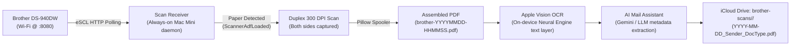

# Brother DS-940DW Driverless Wi-Fi Scan Receiver & AI Mail Sorter

[](LICENSE)


**Hands-free, driverless scan-to-folder and AI mail organization for the Brother DS-940DW duplex scanner.** 

Insert any sheet of paper into the feeder, and it is automatically drawn in, scanned on both sides at 300 DPI, assembled into a clean PDF, and saved straight to your Mac or network folder. No Brother apps, no button presses, and no closed-source drivers required.



---

## Why This Project Exists

The **Brother DS-940DW** is a portable duplex document scanner with built-in Wi-Fi. Normally, Wi-Fi scanning requires opening Brother's proprietary *iPrint&Scan* app on a phone or computer, manually configuring the scan, and clicking Scan on screen. 

Upstream projects relied on Brother's closed-source `brscan5` SANE driver—a proprietary Linux x86-64 binary that cannot run on modern Apple Silicon Macs (M1/M2/M3/M4) or Raspberry Pis without emulation.

This project completely replaces the vendor driver stack with a pure-Python **eSCL (Apple AirScan)** client communicating over local HTTP (`:8080`). It runs natively on **macOS** as a background `launchd` service, on **Linux**, or in multi-arch containers with **zero binary driver dependencies**.

---

## Features

- **Hands-Free Feeder Detection:** Continuously polls the scanner's optical sensor (`<scan:AdfState>`). Sliding a document into the feeder triggers the scan automatically.
- **Zero Proprietary Drivers:** Uses native driverless eSCL (Apple AirScan) over HTTP. Completely eliminates `brscan5` and Ctypes SANE bindings.
- **Full Duplex 300 DPI:** Captures both the front and back of every page in rich 24-bit color and packages them into standard `%PDF-1.4` documents.
- **Apple Silicon Native OCR & AI Organization:**
  - **Apple Vision Framework:** Hardware-accelerated on-device OCR using the Apple Neural Engine in milliseconds.
  - **Spotlight Search:** Every scanned word is immediately indexed by macOS Spotlight (`Cmd + Space` finds text in any document instantly).
  - **AI Titling & Categorization:** Automatically extracts the sender, date, and document type to produce clean filenames (e.g. `2026-11-15_Geico_Auto-Insurance.pdf`) and routes files to category folders (`Bills/`, `Taxes/`, `Medical/`, `Receipts/`).
- **Resource Efficient & Quiet:**
  - Runs in the background under macOS `launchd` consuming **0.0% CPU and ~23 MB RAM** at idle.
  - Gracefully backs off to a 15-second polling interval when the scanner is sleeping, snapping to ready state the moment the scanner wakes.
- **Fault-Tolerant Local Spool:**
  - Scans are staged atomically in `work/spool/` before delivery.
  - Recovers and retries automatically if target folders or network shares are temporarily offline.

---

## Architecture

```
ds-940-paperless-scanner/
├── ds940/
│   ├── config.py       # Configuration and environment parsing
│   ├── escl.py         # Pure-Python driverless eSCL (AirScan) client
│   ├── spool.py        # Atomic PDF assembly and durable job staging
│   ├── worker.py       # Feeder poller, scan dispatcher, and backoff engine
│   └── supervisor.py   # Health monitor and process lifecycle manager
├── scripts/
│   └── run_receiver.sh # LaunchAgent environment runner script
├── assets/
│   └── com.aaron.ds940receiver.plist  # macOS launchd User Agent template
├── tests/              # Comprehensive unit tests with mocked eSCL responses
└── ROADMAP.md          # Web dashboard (Phase 2) & AI pipeline roadmap
```

---

## Quick Start (macOS Always-On Service)

### 1. Requirements
- Brother DS-940DW connected to your Wi-Fi network (with a reserved DHCP IP, e.g. `192.168.0.25`).
- Python 3.9+ with `Pillow`:
  ```bash
  pip3 install Pillow
  ```

### 2. Clone the Repository
Clone the repository into your user workspace (outside iCloud Drive `~/Documents` to prevent TCC sandbox restrictions):
```bash
git clone https://github.com/guitarbeat/ds-940-paperless-scanner.git ~/Projects/ds-940-paperless-scanner
cd ~/Projects/ds-940-paperless-scanner
```

### 3. Verify Local Unit Tests
Run the automated test suite to confirm the eSCL engine, spooler, and state machine pass:
```bash
python3 -m unittest discover tests
```

### 4. Install & Start the `launchd` Service
Copy the provided LaunchAgent configuration to your user Library and load it:
```bash
cp assets/com.aaron.ds940receiver.plist ~/Library/LaunchAgents/
launchctl load -w ~/Library/LaunchAgents/com.aaron.ds940receiver.plist
```

Verify that the process is running:
```bash
launchctl list | grep ds940
ps aux | grep ds940.worker
```

The service logs its activity to:
```bash
tail -f ~/Library/Logs/ds940receiver.error.log
```

---

## Everyday Use

The background service runs 24/7 on your hub machine (e.g. Mac Mini) with minimal resource usage. The scanner can be left powered off until you are ready to scan.

1. **Wake the scanner:** Tap the **Power** button on the DS-940DW. It associates with your Wi-Fi within ~10 seconds.
2. **Insert paper:** Slide a sheet face-up into the document slot. The scanner automatically detects the paper, pulls it through, and scans both sides.
3. **Retrieve PDF:** Within 2 seconds of the sheet exiting, the final duplex PDF appears in your **`brother-scans`** folder in iCloud Drive root.
4. **Auto-sleep:** The scanner enters low-power sleep automatically after 3–5 minutes. The receiver detects the sleep state and backs off quietly.

> [!CAUTION]
> **Do not press the physical "Scan" button on the scanner.** The background receiver manages all scan jobs automatically over eSCL. Pressing the physical button can cause the scanner's firmware to wait for a USB host and display a yellow blinking error LED.

---

## Configuration Reference

All settings can be configured via environment variables in `scripts/run_receiver.sh` or `.env`:

| Variable | Default | Purpose |
|---|---|---|
| `SCANNER_IP` / `SCANNER_HOST` | `192.168.0.25` | Local IPv4 address or mDNS hostname of the scanner. |
| `OUTPUT_DIR` | `~/Library/Mobile Documents/com~apple~CloudDocs/brother-scans` | Directory where finished PDFs are delivered (iCloud Drive root). |
| `WORK_DIR` | `./work` | Staging spool and runtime status directory (`auto-status.json`, `worker.lock`). |
| `SCAN_PAPER_SIZE` | `a4` | Paper bounds (`a4`, `auto`, or `legal`). |

---

## Service Management (macOS)

To inspect, reload, or stop the service on macOS, follow standard `launchctl` commands:

- **Check status:**
  ```bash
  launchctl list | grep ds940
  ```
- **Inspect live logs:**
  ```bash
  tail -f ~/Library/Logs/ds940receiver.error.log
  ```
- **Stop service:**
  ```bash
  launchctl unload ~/Library/LaunchAgents/com.aaron.ds940receiver.plist
  ```
- **Restart service:**
  ```bash
  launchctl unload ~/Library/LaunchAgents/com.aaron.ds940receiver.plist
  launchctl load -w ~/Library/LaunchAgents/com.aaron.ds940receiver.plist
  ```

---

## HTTPS Reverse Proxy (Caddy)

The repository includes a built-in Caddy configuration to securely expose the local dashboard (`127.0.0.1:9400`) over TLS:

- **Configuration:** [`caddy/Caddyfile`](caddy/Caddyfile) configured for `scans.alw.lol:8443` using Cloudflare DNS-01 ACME challenge.
- **Runner Script:** [`scripts/run_caddy.sh`](scripts/run_caddy.sh)
- **Authentication:** Automatically reads Cloudflare token from `~/.caddy_cloudflare_token`.
- **LaunchAgent Service:** Managed via `~/Library/LaunchAgents/com.aaron.caddy.plist`.

---

## Troubleshooting

| Symptom | Cause | Solution |
|---|---|---|
| `Cannot reach scanner: No route to host` or `timed out` | Scanner is in low-power sleep or turned off. | Tap the Power button on the scanner to wake it up. The service will automatically reconnect within 15 seconds. |
| `Scanner busy (HTTP 409)` | Another application or previous job holds the scanner. | Wait 30 seconds for firmware timeout, or toggle scanner power off and on. |
| `Paper jammed in scanner feeder` | A sheet got caught or the cover was opened during scan. | Open the guide, remove the obstruction, and ensure the paper output flap is open for long documents. |
| `Operation not permitted (getcwd)` | macOS TCC privacy restriction. | Ensure Full Disk Access is granted if needed for the background daemon to access iCloud Drive. |

---

## Roadmap

- [x] **Phase 1: Driverless eSCL Engine & launchd Service** (Completed)
- [ ] **Phase 2: Web Dashboard & Menu Bar Control**
  - Lightweight web GUI at `:9400` for changing output folders, polling rates, and scan profiles.
  - macOS menu bar icon showing live status and quick scan shortcuts.
- [ ] **Phase 3: Native Apple Vision OCR & AI Mail Assistant**
  - Instant on-device Apple Neural Engine text layer generation.
  - Gemini / LLM metadata extraction (date, sender, document type).
  - Automatic filing and tagging into `iCloud Drive/brother-scans/<Category>/`.
- [ ] **Optional Paperless-ngx Ingestion:** Direct REST API forwarding to self-hosted Paperless-ngx instances.

See [`ROADMAP.md`](ROADMAP.md) for complete technical specifications.

---

## License

This project is licensed under the [MIT License](LICENSE).
